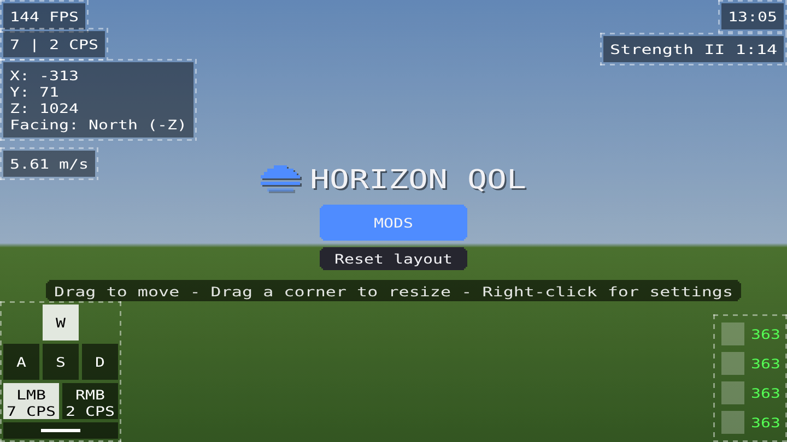

# Horizon QoL

Quality-of-life tweaks for [Horizon](https://github.com/horizon-rust/horizon), the Rust rewrite of
Minecraft: Java Edition 26.3, with a client-style mod menu and a HUD editor.



## Using it

- **Right Shift** opens the HUD editor. Drag an element to move it (it snaps to the screen's
  edges and middle and to other elements, with a blue guide line). Drag one of its corner
  handles to resize it, like a window: the opposite corner stays put. Scrolling over it resizes
  it too. Right-click it for its settings. **Reset layout** puts every element back.
- **Mods** in the middle opens the mod menu: switch modules on and off, search them, and press
  `...` on a card for its settings. **Edit HUD** goes back to the editor.
- Right Shift or Esc closes it. Both keys the mod uses (**Open Mod Menu** and **Zoom**) are in
  *Options > Controls* under Horizon QoL, where you can rebind them.
- Settings are saved when you close the screen, in `config/horizon_qol/settings.txt` in the game
  folder.


## Modules

| Module | What it does | Settings besides the common ones |
| --- | --- | --- |
| FPS | Frames per second | Show label |
| CPS | Clicks per second, left and right | Show right clicks, show label |
| Keystrokes | W A S D, both mouse buttons and the space bar, lit while held | Mouse buttons, space bar, CPS on the mouse keys, pressed colour |
| Coordinates | X, Y, Z, the way you face, the dimension | Direction, dimension, decimals |
| Speed | Blocks per second | Count vertical speed |
| Armor Status | Your armor and held item with durability | Durability, as percent, held item |
| Potion Effects | Active effects with level and time left | Show level |
| Clock | Real-world time | 24-hour, seconds, time zone (UTC offset) |
| Toggle Sprint | Sprints for you while you walk forward | |
| Zoom | Hold C to zoom; scroll while zooming to zoom more or less | Zoom amount, smooth, scroll to adjust, slower mouse |

Every HUD module also has **Scale**, **Text colour**, **Text shadow**, **Background** and
**Background opacity**. FPS, Coordinates and Zoom are on to start with.

Notes:
- Toggle Sprint leaves the game's own *Toggle Sprint* option alone: with that option on, it does
  nothing, since holding the key would flip sprinting.
- The Clock can't read your computer's time zone through the game, so set yours with the
  time-zone slider (UTC+1 for central Europe, for example).


## Building and installing

This is a native Horizon mod: the launcher compiles it for your instance. You need the Horizon
launcher and the mod tool:

```sh
cargo install --locked --git https://github.com/horizon-rust/horizon cargo-horizon-mod
```

### From this folder (works for a private repo)

1. Pack the mod. This fetches the pinned SDK into `.horizon/sdk/` the first time:

   ```sh
   cargo horizon-mod build
   ```

   It writes `target/horizon-mod/horizon_qol.hmod`.
2. In the launcher, open **Mods**, then **Open folder**: that is the instance's game folder (the one
   with `options.txt`). Copy `horizon_qol.hmod` into its `horizon-native-mods/` folder (make it if
   it isn't there).
3. Turn the mod on: in the same game folder, add this line to `horizon-mods.txt` (make the file if
   it isn't there), or flip its switch on the Mods page:

   ```text
   mod.horizon_qol:true
   ```
4. Press **Build** on the Mods page (or **Play**), then join a world.

When the mod has loaded, chat says **"[Horizon QoL] Loaded. Press Right Shift to open the menu."**
when you join a world. No line means the launcher didn't build it: check step 3 and the build log
(`native/build.log`).

After a change, run `cargo horizon-mod build` again, copy the new `.hmod` over the old one, and build.

### From GitHub (public repo only)

On the launcher's **Mods** page, **Add from GitHub** with `https://github.com/dijakonal/horizon-qol`.

### The pin

`horizon-mod.toml` pins the Nightly of 2026-11-20 (`0a875da`). The launcher builds the mod against
that exact game build. `cargo horizon-mod update` moves the pin to the newest Nightly.

## Layout

```text
horizon-mod.toml          the manifest: id, side, and the pinned Horizon build
Cargo.toml                depends only on horizon-mod-api from the pinned SDK
src/lib.rs                the hooks: key mappings, reading the game, drawing the HUD, zoom, sprint, saving
src/modules.rs            the modules, their settings and default places; the config file's text
src/settings.rs           switches, sliders and colours, and reading and writing them
src/hud.rs                what each HUD element shows, its size, and drawing it scaled
src/ui.rs                 the screen: the HUD editor and the mod menu
src/ui/tests.rs           the screen's tests, with a fake draw context that can write SVG previews
assets/horizon_qol/lang/  the key mappings' names in Options > Controls
```

## Tests

`cargo test` checks the screen's clicks, drags, snapping, sliders and the HUD's text with a fake
draw context, without the game. `HORIZON_QOL_PREVIEW=<folder> cargo test` also writes each tested
frame as an SVG, which is how the pictures in `docs/` were made (the font there is a stand-in).

## Next steps

- More modules: a custom crosshair, reach display, combo counter, ping (it needs a client-side
  read Horizon doesn't have yet), fullbright (it needs a brightness hook).
- Profiles: several saved HUD layouts to switch between.
