<p align="center">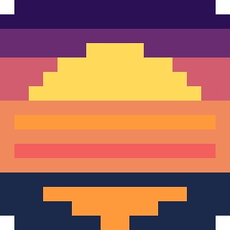</p>

# Horizon QoL

Quality-of-life tweaks for [Horizon](https://github.com/horizon-rust/horizon), the Rust rewrite of
Minecraft: Java Edition 26.3, with a client-style mod menu and a HUD editor.


## Using it

- **Right Shift** opens the HUD editor. Drag an element to move it (it snaps to the screen's
  edges and middle and to other elements, with a blue guide line). Drag one of its corner
  handles to resize it, like a window: the opposite corner stays put. Scrolling over it resizes
  it too. Right-click it for its settings. **Reset layout** puts every element back.
- **Mods** in the middle opens the mod menu. Click anywhere on a module's card for its settings;
  the ENABLED / DISABLED bar on the card switches it on and off. Search with the box at the top.
  **Edit HUD** goes back to the editor.
- **Options > Mods > Horizon QoL > Config** opens the HUD editor while you're in a world (or the
  mod menu, if its one setting there says so). On the title screen, where mods can't open their
  own screens, it shows that setting and a reminder of where the menu is.
- Drag a corner to resize an element (it keeps its shape; the corner stays on the cursor along
  its diagonal). Hold **Shift** while dragging a corner to set its width and height separately:
  the width is stretched against the height (the *Width stretch* setting).
- Right Shift or Esc closes it.
- Settings are saved when you close the screen, in `config/horizon_qol/settings.txt` in the game
  folder.

### Keys

All of the mod's keys are in *Options > Controls* under Horizon QoL. Each module's settings page
shows the keys it uses too, and changes them: click a key, then press the new one (Escape
cancels, Backspace leaves it unbound, a right-click puts back the default).

| Key | Default | Does |
| --- | --- | --- |
| Open Mod Menu | Right Shift | Opens the HUD editor |
| Zoom | C | Zooms while held, or on and off in Toggle mode |
| Freecam | F6 | Freecam on or off |
| Start / Stop Recording | F7 | Starts a recording for Replay Studio, or stops and saves it |
| Toggle Sprint | Y | Sprinting on or off, while Toggle Sprint & Sneak is on |
| Toggle Sneak | not bound | Sneaking on or off, while Toggle Sprint & Sneak is on |
| Voice Chat Menu | V | Opens the Voice Chat page (as Simple Voice Chat's menu key does) |
| Push to Talk | Caps Lock | Talks while held, in push-to-talk mode |
| Whisper | not bound | Talks to the players right next to you only |
| Mute Microphone | J | Mutes or unmutes your microphone |
| Voice Chat Off / On | K | Turns voice chat off or on for the moment |

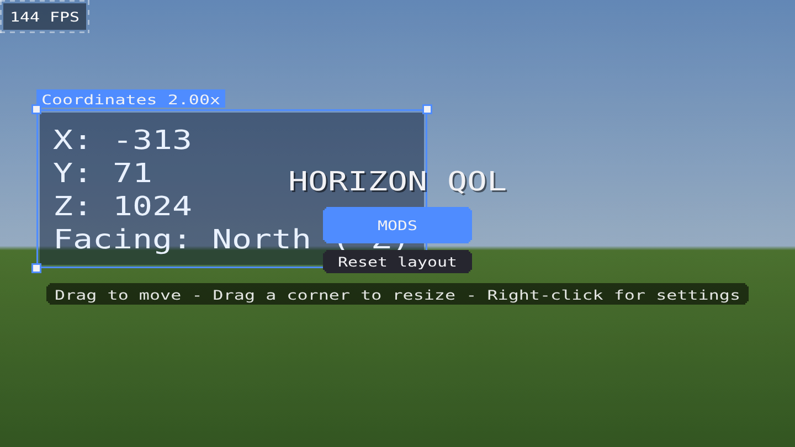

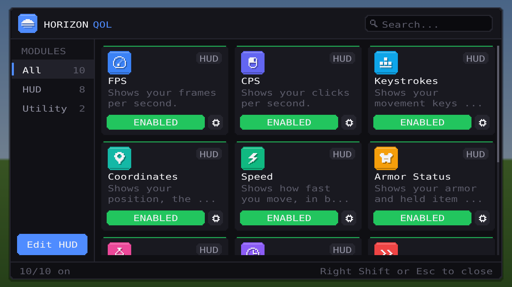

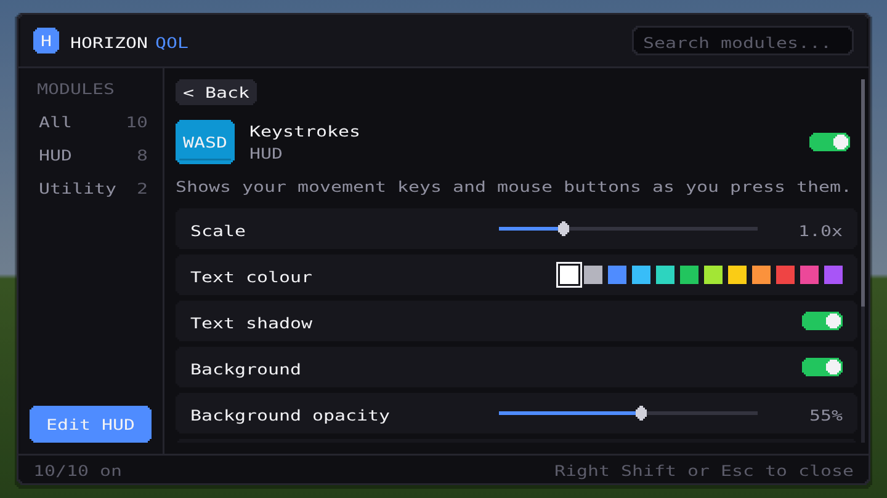

## Modules

| Module | What it does | Its own settings |
| --- | --- | --- |
| FPS | Frames per second | Format |
| CPS | Clicks per second, left and right | Right clicks, label |
| Keystrokes | The keys you press, in three modes (below) | Mode, key size, key gap, pressed colour, fade-out, and each mode's options |
| Coordinates | X, Y, Z, the way you face, the dimension | Lines or one line, direction, dimension, decimals |
| Speed | How fast you move | Vertical speed, m/s or km/h |
| Armor Status | Your armor and held item with durability | Vertical or horizontal, durability, as percent, held item |
| Potion Effects | Active effects with level and time left | Level, time left |
| Clock | Real-world time | 24-hour, seconds, time zone (UTC offset) |
| Toggle Sprint & Sneak | Its keys switch sprinting and sneaking on and off | Each on or off, their keys, status on the HUD, keep sprinting after a restart |
| Scoreboard | The server's sidebar scoreboard as a HUD element you can move and resize | Score numbers (off to start with), title, text shadow, background colour and opacity, title band |
| Freecam | Its key (F6) flies the camera away from your player, through blocks; your player stays still | Key, speed, level or where-you-look flight, see your player, clear water and lava fog |
| Skins & Capes | The skin manager: imported skins and capes, and your account's | Button on the pause menu |
| Replay | Records what you play for Horizon's Replay Studio, as ReplayMod does | Record key, record by itself (off, servers, single player, everywhere), chat messages |
| Recording Indicator | REC and how long, on the HUD, while Replay records | Show the time, and the look every element has |
| Zoom | Zoom in; scroll while zooming to zoom more or less | Key, hold or toggle, zoom amount, smooth, scroll to adjust, slower mouse |
| HUD | Every HUD element on or off, and their rule for F3 and the chat | When F3 is open, when the chat is open |
| Voice Chat | Proximity voice chat on servers that run Simple Voice Chat | Talk mode, levels, mute, sounds, keys, its pages |
| Voice Status, Voice Group, Voice Speakers | Voice chat's HUD | Icon or icon and text (status), scale, background, most players, names |
| Shulker Preview | A shulker box's tooltip shows its items as a grid of slots instead of the game's list, in the box's colour | Always or hold Shift, coloured tooltip, hide the game's list, Shift hint |
| Ender Chest Preview | An ender chest's tooltip shows your ender chest as it was when you last opened one | Always or hold Shift, when it was last seen, Shift hint |

### Voice chat

Talk to the players near you on any server that runs the
[Simple Voice Chat](https://modrinth.com/plugin/simple-voice-chat) plugin or mod, and they hear
you, whether they play Horizon or Java Edition. It has positional audio, push-to-talk or voice
activation, groups (with passwords), whispering, and per-player volume.

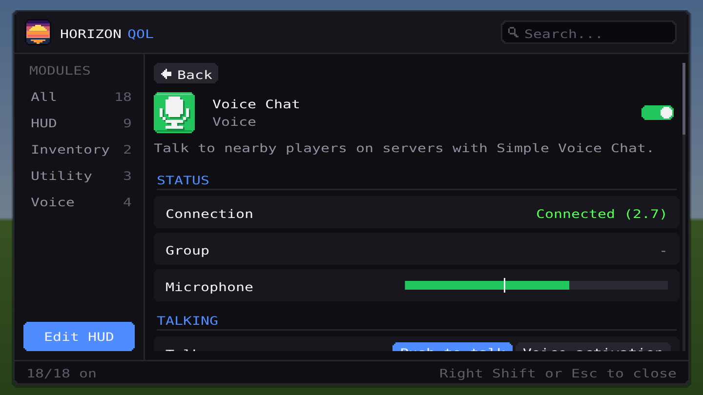

**V** (or the Voice Chat card) opens its page in the mod menu:

- **Status:** the connection, your group, and a live microphone meter with the voice
  activation level marked, so you can see what will be sent.
- **Talking:** push to talk or voice activation, the activation level, mute, and voice off.
- **Volume:** voices and your microphone's gain.
- **Sounds:** short sounds for connecting and disconnecting, pressing and letting go of push to
  talk, muting and turning voice off, and joining and leaving groups (and someone joining
  yours), each on or off, with a volume.
- **Keys:** what each key is bound to; click one to change it.
- **More:** buttons for its Groups, Player volumes and Audio devices pages.

Its HUD is three elements in the **Voice** tab, edited like any other in the HUD editor (drag,
resize, background, visibility):
- **Voice Status:** an icon for connecting, talking, whispering, muted or off (or the icon with
  its words).
- **Voice Group:** your group.
- **Voice Speakers:** who's talking and your group's members, with their faces (at most a set
  number, names optional).

The game draws these, since it has the players' skins, where the editor puts them.

- A server without Simple Voice Chat has no voice. The server's voice UDP port must be reachable
  from your computer. Its settings are kept in `config/horizon_qol-client.toml`.
- Privacy: while voice chat is on and connected, your microphone stays open for the live level
  meter, also in push-to-talk mode. In push-to-talk mode, audio is sent only while Push to Talk or
  Whisper is held (plus a short tail). Audio is never written to disk. The Voice Chat module's
  switch turns all of it off: no connection, no microphone.
- Voice chat is [JKearnsl's Voice Chat for Horizon](https://github.com/JKearnsl/voice-chat) (MIT),
  built into this mod and reworked here. It is not made by or affiliated with Simple Voice Chat or
  its author. Its Opus codec is a Rust port of libopus (BSD-3-Clause). Both licences are in
  `licenses/`.
- Voice chat changes some of the game's own code (its audio output, HUD and name tags), so the
  launcher downloads a larger SDK and builds a game patch the first time. It also builds two
  crates.io packages (`aes-gcm` and its dependencies), pinned in `Cargo.lock`. The launcher asks
  before running their build scripts.

### Profiles

The menu's **Profiles** button (above Edit HUD) keeps sets of settings: every module's settings,
the HUD layout and the mod's keys.

- **Save:** type a name and press Save. That profile is now in use, and changes save to it.
- **Load:** switches to a profile (its keys too). **Delete** asks once more before it deletes.
- **Export:** copies a profile, or your settings as they are, to the clipboard as text you can
  paste in a message.
- **Import from clipboard:** reads a profile someone sent you, saves it and loads it.

Profiles are files in `config/horizon_qol/profiles/`, in the same `key=value` text.

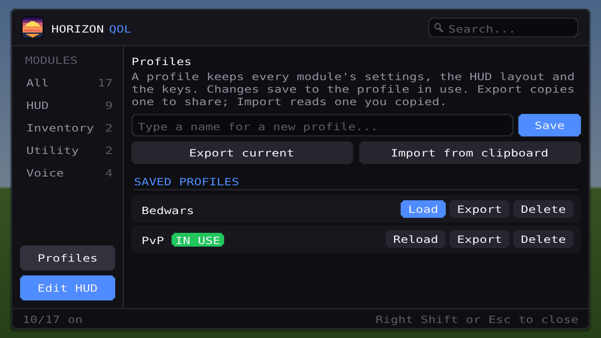

### Skins & Capes

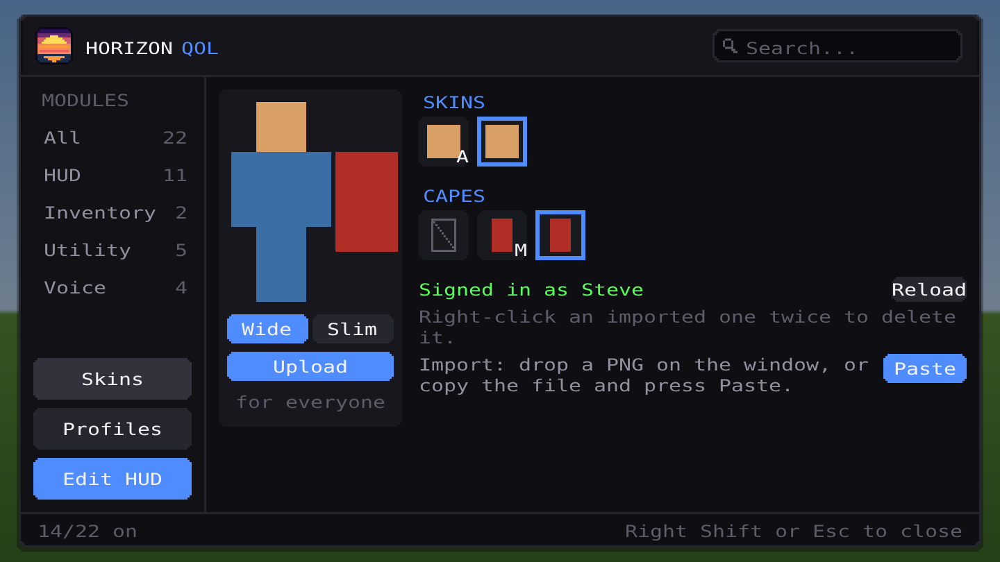

Press **Escape**: the pause menu has a **Skins & Capes** button in its bottom-left corner (also the
*Skins* button in the mod menu's sidebar). The skin manager shows your player as you look, then
your skins and capes as tiles: click one to wear it.

- **Import** a skin or cape by dragging its PNG onto the game window while the skin manager is
  open, or copy the file (or its path) and press **Paste**. A 64x64 image is a skin; a 64x32
  one is a cape (dropped over the skins, an old-style skin). They're kept in
  `config/horizon_qol/skins/` and `config/horizon_qol/capes/`.
- **Skins:** *A* is your account's; an imported one shows on you right away. **Upload** makes it
  your Microsoft account's skin, so everyone sees it (after you rejoin a server). Wide or slim
  arms are worked out from the image, and you can change them.
- **Capes:** none, your account's capes (*M*, from Mojang: picking one makes it the cape
  everyone sees), and imported ones. **An imported cape shows only to you**: there's no cape
  service for other players to see it from.
- Right-click an imported tile twice to delete it.
- With an offline name (no Microsoft sign-in), imported skins and capes work, for you only.

### Replay

Horizon has ReplayMod's other half built in: its **Replay Studio** (Options > Horizon Settings >
Replay Studio) lists your recordings and plays them back, with a timeline, a free camera,
keyframes and camera paths, and the recordings are `.mcpr`, ReplayMod's own format. What it
lacks is an easy way to record: only the `/studio record` chat command. The **Replay** module
(Utility tab) adds that:

- **F7** starts a recording, and stops and saves it.
- **Record by itself:** a recording can start a few seconds after you join a server, a single
  player world, or both (off to start with). Stopping one by hand keeps it stopped until you
  next join.
- A recording starts only once you've fully joined the world, so it begins with the world loaded.
- **REC** and how long it has run show on the HUD while it records: that's the **Recording
  Indicator** module (HUD tab), which you switch off, move and resize like any element. The
  Replay module's page shows the status and size.
- Leaving the world saves the recording. They go in `recordings/` in the game folder.

### F3, the chat and containers

The **HUD** module (in the HUD tab) is the switch for every HUD element, and says what they do
while F3, the chat or a container (a chest, the inventory...) is open: by default they make way
for F3 and containers and stay over the chat. Each element's **Visibility** settings follow it
(Global) or choose their own (Hide or Show). Nothing shows on the title screen or while the game
is paused.

### Container previews

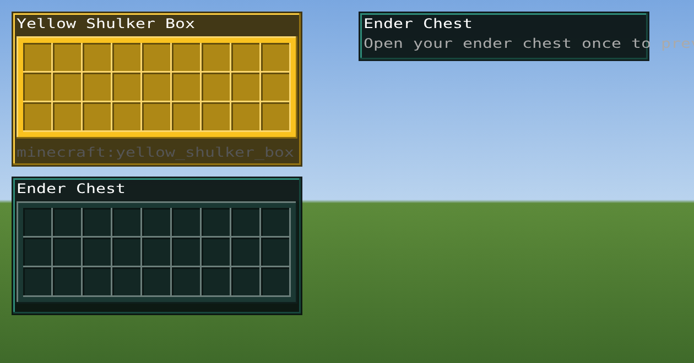

Hover a shulker box anywhere (your inventory, a chest, the creative tabs) to see what's in it,
slot for slot. The box carries its items, so this is always exact.

The game sends your ender chest to your client only while one is open. So the ender chest
preview shows what it held the last time you opened one, and the tooltip says how long ago that
was. It is remembered separately for each world and server, and kept across restarts in
`horizon-mod-data/horizon_qol/ender_chests/` in the game folder. Until you've opened your ender
chest in a world or on a server, its tooltip says to open it once.

Both are drawn in their block's colours (a dyed box's own colour, the ender chest's obsidian and
teal), tooltip box included, and their tooltip sits a little higher than the game's so it covers
less of the slots around the cursor (*Move the tooltip up*).

Every element on the HUD also has these, in two groups:
- **Text:** scale, colour, rainbow text and its speed, shadow, brackets `[ ]`, and line alignment.
- **Background:** on or off, colour, opacity, a border and its colour, and padding.

FPS, Coordinates and Zoom are on to start with.

### Keystrokes modes

- **WASD:** W A S D, both mouse buttons (with CPS) and the space bar.
- **Keyboard:** a keyboard map that lights every key you press.
  - **Layout:** Auto, US, UK, QWERTZ (German), AZERTY (French), Dvorak or Colemak. The UK,
    QWERTZ and AZERTY boards have the ISO shape: the extra key left of Z and the tall Enter.
    **Auto** works out your layout from what you type: the game reports both the key you pressed
    and the letter your layout made of it. It starts as US and changes once you've typed a few
    letters that tell layouts apart, and it switches to UK when you press the ISO key.
  - **Size:** 60% (the main keys), TKL (adds Insert, Home, Page Up/Down and the arrows) or Full
    (adds the number pad). Esc and F1-F12 are optional.
- **Controller:** an Xbox, PlayStation or Switch Pro controller, each with its own shape, button
  layout and labels (Xbox's coloured A B X Y, PlayStation's ✕ ○ □ △, Switch's B A Y X). The
  controller's colour and opacity are settings. Buttons light as their actions happen (south
  jump, west swap hands, north inventory, the triggers use and attack, stick clicks sprint and
  sneak, the D-pad's drop, pick and chat). The left stick leans the way you move and the right
  stick the way you turn. Horizon gives mods no direct read of a pad, so the controller shows
  what the game does with your input. That also works with keyboard and mouse. The bumpers don't
  light, since hotbar changes aren't visible to a mod.

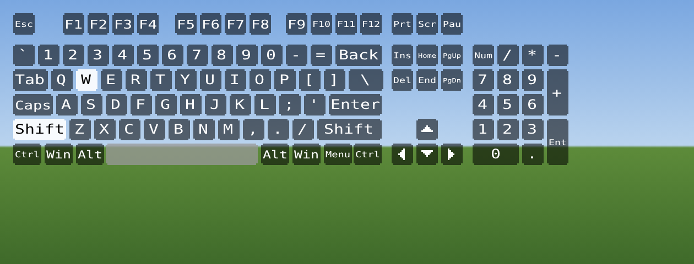

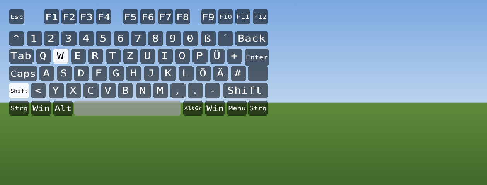

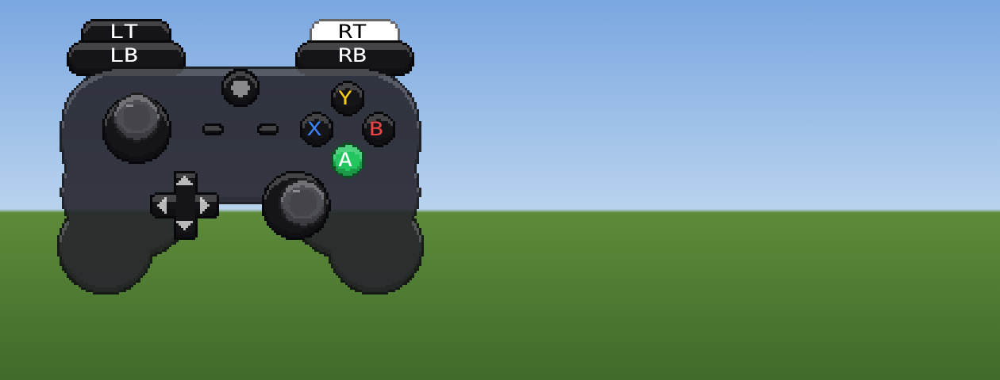

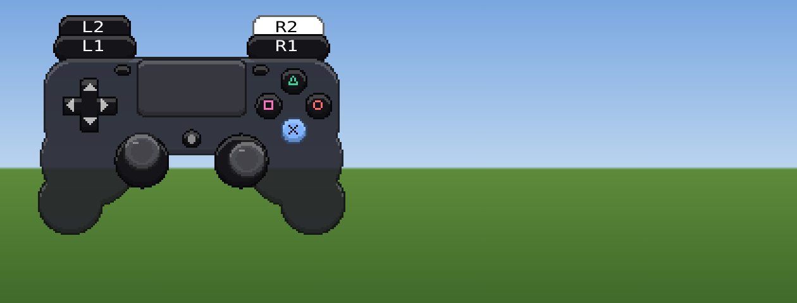

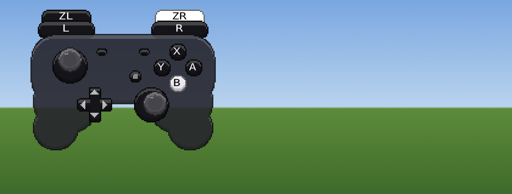

Notes:
- Toggle Sprint & Sneak leaves the game's own *Toggle Sprint* and *Toggle Sneak* options
  alone: with the game's option on, that half does nothing, since holding the key would flip it.
- The mod API can read a key but not change it, so a key changed in the menu is bound by the
  mod's game-side tick code (`src/voice/mixins/tick.rs`), the same way Controls binds it, and
  saved with the game's options. It shows in Controls too.
- The Clock can't read your computer's time zone through the game, so set yours with the
  time-zone slider (UTC+1 for central Europe, for example).

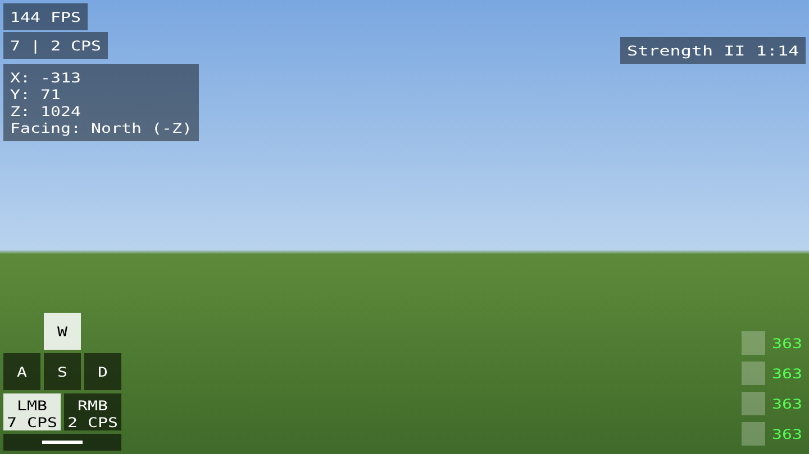

## Building and installing

This is a native Horizon mod: the launcher compiles it for your instance. You need the Horizon
launcher and the mod tool:

```sh
cargo install --locked --git https://github.com/horizon-rust/horizon cargo-horizon-mod
```

### From this folder (works for a private repo)

1. Pack the mod. This fetches the pinned SDK into `.horizon/sdk/` the first time:

   ```sh
   cargo horizon-mod build
   ```

   It writes `target/horizon-mod/horizon_qol.hmod`.
2. In the launcher, open **Mods**, then **Open folder**: that is the instance's game folder (the one
   with `options.txt`). Copy `horizon_qol.hmod` into its `horizon-native-mods/` folder (make it if
   it isn't there).
3. Turn the mod on: in the same game folder, add this line to `horizon-mods.txt` (make the file if
   it isn't there), or flip its switch on the Mods page:

   ```text
   mod.horizon_qol:true
   ```
4. Press **Build** on the Mods page (or **Play**), then join a world.

When the mod has loaded, Right Shift opens its HUD editor in a world, and the Mods page shows
Horizon QoL with its logo. If neither, the launcher didn't build it: check step 3 and the build
log (`native/build.log`).

After a change, run `cargo horizon-mod build` again, copy the new `.hmod` over the old one, and build.

### From GitHub (public repo only)

On the launcher's **Mods** page, **Add from GitHub** with `https://github.com/dijakonal/horizon-qol`.

### The pin

`horizon-mod.toml` pins the Nightly of 2026-11-20 (`0a875da`). The launcher builds the mod against
that exact game build. `cargo horizon-mod update` moves the pin to the newest Nightly.

## Layout

```text
horizon-mod.toml          the manifest: id, side, and the pinned Horizon build
Cargo.toml                depends only on horizon-mod-api from the pinned SDK
src/lib.rs                the hooks: key mappings, reading the game, drawing the HUD, zoom, toggles, saving
src/modules.rs            the modules, their settings and default places; the config file's text
src/settings.rs           switches, sliders, colours, choices, keybind rows and headings; reading and writing them
src/icons.rs              the pixel-art icons, drawn from small bitmaps
src/hud.rs                what each HUD element shows, its size, and drawing it scaled; Keystrokes' three modes
src/hud/keyboard.rs       the keyboard layouts and sizes, and Auto's layout detection
src/hud/pad.rs            the controllers, drawn and shaded from circles and rounded rectangles
src/voice/                voice chat: its engine, settings file, Opus codec (opus-rs) and game-side code (mixins)
src/profiles.rs           profiles: their text (what Export copies), names and files
src/previews.rs           shulker box and ender chest previews: reading their items, the slot grid, the saved ender chests
src/ui.rs                 the screen: the HUD editor and the mod menu
src/mixins/               the mod's own game-side code: the Config button, the logo on the Mods page, the scoreboard,
                          the skin manager (drawing your skin and cape, Mojang's profile API, dropped files)
src/scoreboard.rs         the Scoreboard module's look, for its game-side code
src/wardrobe.rs           the skin manager's shared state (with its game side), image sizes and the front view's pixels
src/skin_manager.rs       the skin manager: imported files, picks, importing, what its page shows
src/ui/wardrobe.rs        the skin manager's page
src/replay.rs             Replay: recordings the mod asks for and how they go, shared with the game-side tick
src/freecam.rs            Freecam's camera: turning, flying, and where each frame is drawn from
icon.png                  the logo, drawn from LOGO_ART in src/icons.rs by tools/logo.py
src/ui/tests.rs           the screen's tests, with a fake draw context that can write SVG previews
assets/horizon_qol/        the key mappings' names in Options > Controls, and voice chat's textures
licenses/                 the licences of the code voice chat is built from
```

## Tests

`cargo test` checks the screen's clicks, drags, snapping, sliders and the HUD's text with a fake
draw context, without the game. `HORIZON_QOL_PREVIEW=<folder> cargo test` also writes each tested
frame as an SVG, which is how the pictures in `docs/` were made (the font there is a stand-in).

## Next steps

- More modules: a custom crosshair, reach display, combo counter, ping (it needs a client-side
  read Horizon doesn't have yet), fullbright (it needs a brightness hook).
- Profiles: several saved HUD layouts to switch between.
